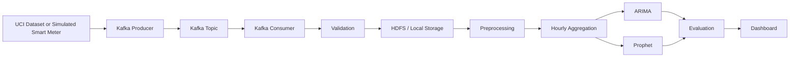

# Smart Building Energy Forecasting

This project builds an end-to-end prototype for forecasting hourly electricity demand in a smart building using a Kafka ingestion pipeline, HDFS-compatible storage, preprocessing, and time-series forecasting with ARIMA and Prophet.

## 1. Project introduction

The system reads the UCI Individual Household Electric Power Consumption dataset, converts the minute-level readings into hourly demand data, ingests the measurements via Kafka, stores records in a local/HDFS-style storage layer, trains forecasting models, and exposes the resulting forecasts via a Streamlit dashboard.

## 2. Problem statement

Facility managers often lack visibility into future electricity demand and therefore struggle to shift flexible loads away from peak periods. This prototype aims to forecast hourly demand for the next 24 hours so that peak periods can be anticipated and managed.

## 3. Objectives

- Ingest data through Kafka with validation.
- Store raw and processed records in a distributed or local storage layer.
- Clean and aggregate one-minute readings into hourly consumption.
- Train and evaluate ARIMA, Prophet, and a baseline model.
- Highlight the expected peak-demand interval.
- Present results through a Streamlit dashboard.

## 4. Dataset details and limitations

The prototype uses the UCI household power consumption dataset. The key variable is Global_active_power, which is recorded in kilowatts and measured at one-minute intervals.

Important notes:

- The dataset contains missing values and malformed records.
- The minute-level readings are resampled into hourly averages.
- The global_active_power column is treated as active demand in kW.
- This is a single-meter prototype, with a field for building_id that can later support multiple sites.

## 5. System architecture



## 6. Technology stack

- Python
- Pandas
- NumPy
- PyArrow
- Statsmodels
- Prophet
- Kafka
- Streamlit
- Plotly
- pytest

## 7. Folder structure

- app.py
- requirements.txt
- .env.example
- docker-compose.yml
- README.md
- config/
- data/
- kafka/
- storage/
- preprocessing/
- forecasting/
- dashboard/
- tests/
- scripts/

## 8. Installation instructions

1. Clone the repository.
2. Create a virtual environment.
3. Install dependencies:

```bash
python3 -m venv .venv
source .venv/bin/activate
pip install -r requirements.txt
```

## 9. Environment configuration

Copy the example environment file and adjust values as needed:

```bash
cp .env.example .env
```

Key variables:

- KAFKA_BROKER
- KAFKA_TOPIC
- HDFS_URL
- LOCAL_STORAGE_PATH
- DATASET_URL

## 10. Kafka setup

For local development, start Kafka with Docker Compose:

```bash
docker compose up -d
```

You can also validate the Kafka topic with the included producer and consumer modules.

## 11. HDFS setup

The project supports:

- Local fallback storage for development.
- Optional HDFS connectivity through the HDFS client abstraction.

For distributed deployment, point HDFS_URL to your NameNode service and ensure connectivity before enabling distributed processing.

## 12. Data preprocessing

The preprocessing layer:

- Parses Date and Time from the UCI dataset.
- Validates numeric entries.
- Drops invalid or missing values.
- Sorts by timestamp.
- Deduplicates repeated timestamps.
- Resamples minute-level observations to hourly averages.
- Saves the processed result to the local processed directory.

## 13. Forecasting methodology

The project compares three forecasting candidates:

- ARIMA for autoregressive demand modeling.
- Prophet for trend and seasonal forecasting.

The seasonal-naive baseline repeats the previous day's same-hour profile. Before producing the next-24-hour forecast, the pipeline holds out the latest 24 hours, scores each available candidate by MAE, and selects the best one. Forecasts are clipped at zero because negative electricity demand is not meaningful for this dataset. The dashboard displays each candidate's holdout MAE and uses the selected model for its forecast and alert.

## 14. Model evaluation

The evaluation module calculates:

- MAE
- RMSE
- MAPE

The code handles near-zero actual values by using a small epsilon denominator so that the metric remains stable and interpretable.

## 15. Dashboard usage

Launch the dashboard with:

```bash
streamlit run app.py
```

The dashboard shows:

- overview metrics
- historical demand
- next-24-hour forecast
- model comparison
- peak-demand alert threshold

Changing the dashboard's start or end date refits the forecast using only the hourly readings in that range. The dashboard refreshes `data/processed/next_24h_forecast.csv` with that range's forecast and `data/processed/forecast_comparison.csv` with its latest 24-hour holdout predictions (when enough history is selected).

## 16. Testing instructions

Use the project tests as follows:

```bash
PYTHONPATH=. pytest -q
```

The tests cover:

- timestamp parsing
- missing and invalid readings
- hourly resampling
- duplicate detection
- metric computation
- peak demand logic

## 17. Troubleshooting

- Kafka unavailable: check Docker Compose status and port availability.
- Missing dataset: run the download script.
- HDFS failure: the code falls back to local storage automatically.
- Prophet import error: install the dependencies in requirements.txt.

## 18. Known limitations

- This is a single-building prototype rather than a multi-building deployment.
- HDFS integration depends on external cluster availability.
- Forecast quality depends on the quality and availability of the observed data.

## 19. Future enhancements

- Multi-building support using building_id as the partition key.
- More advanced SARIMA tuning.
- Retraining workflows with model versioning.
- Real-time Kafka data ingestion from live meters.
- Deployment to a cloud-based orchestrator.

## 20. How data moves through the system

The data path starts with the raw dataset or synthetic meter stream, which is published to Kafka. A consumer validates the data and stores the raw input to a local or HDFS-like storage layer. The preprocessing module cleans the timestamps, handles invalid values, aggregates to hourly averages, and saves the result. The forecasting engine reads the hourly data, fits ARIMA and Prophet, evaluates them, and writes the next-24-hour output to the dashboard.
